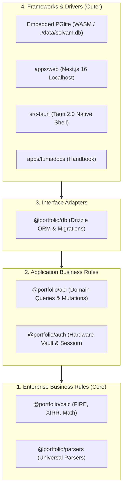

<IconCardGrid columns={3}>
  <IconCard
    icon="AppWindow"
    title="Native & PWA Shell"
    description="Tauri 2.0 native binaries for macOS, Windows, Linux, and Android, alongside local Next.js 16 PWA."
  />
  <IconCard
    icon="Database"
    title="Embedded PGlite"
    description="WASM-powered embedded PostgreSQL storing directly to ./data/selvam.db with zero cloud dependencies."
  />
  <IconCard
    icon="ShieldCheck"
    title="Hardware Vault"
    description="AES-256-GCM authenticated encryption with PBKDF2-SHA512 key derivation and zero-cloud sovereign auth."
  />
</IconCardGrid>

## Application stack

| Concern                    | Decision                                           | Why it matters                                                                                                                                                                                          |
| -------------------------- | -------------------------------------------------- | ------------------------------------------------------------------------------------------------------------------------------------------------------------------------------------------------------- |
| **Native Application**     | Tauri 2.0 (Rust)                                   | Compiles to native desktop and mobile binaries (`.dmg`, `.exe`, `.AppImage`, `.deb`, `.apk`) with a tiny memory footprint and direct OS hardware access.                                                |
| **Web Runtime**            | Next.js 16 App Router and React 19                 | Server Components keep financial computations on the local host; route handlers provide strictly typed mutation boundaries.                                                                             |
| **Interface**              | Tailwind CSS, shadcn/ui New York, and ECharts      | Consistent dashboard visual system with responsive, interactive financial charts and 6-second ephemeral financial stories pulse.                                                                        |
| **Pure Calculations**      | `@portfolio/calc`                                  | Zero-dependency, pure deterministic calculation engine for FIRE simulations, XIRR returns, net worth aggregation, and currency conversions (66 tests passing).                                          |
| **Universal Parsers**      | `@portfolio/parsers`                               | Pure statement parsers for multi-broker tradebooks (Zerodha, Degiro), bank statements, and payslips without database or filesystem side effects (17 tests passing).                                     |
| **Database Engine**        | Embedded PGlite (WASM PostgreSQL)                  | Complete PostgreSQL database running in-process via WebAssembly, saving to `./data/selvam.db`. All 70 relational tables migrate in ~450ms without Docker. Optional external Postgres support preserved. |
| **Data Access**            | Drizzle ORM and tracked SQL migrations             | Type-safe schema, relational queries, and reviewable migrations enforcing account ownership constraints.                                                                                                |
| **Authentication & Vault** | Sovereign Vault & Better Auth                      | Authenticated AES-256-GCM hardware vault (`SELV` header, 100,000 PBKDF2-SHA512 iterations) with automatic session provisioning for sovereign local operation.                                           |
| **Document Vault**         | Local Filesystem Vault (`./data/vault/documents/`) | High-speed encrypted local file retention with SHA-256 checksums, replacing mandatory cloud storage dependencies.                                                                                       |
| **FX Conversion**          | Direct European Central Bank (ECB) Reference Rates | Direct daily reference XML feed from the ECB with zero third-party aggregators and zero API keys required.                                                                                              |
| **Monorepo**               | pnpm workspaces and Turborepo                      | Independent caching and compilation for native desktop, web application, domain engines, database, and documentation.                                                                                   |

## Package boundaries

```text
src-tauri         Native desktop & mobile shell (Tauri 2.0 Rust)
apps/web          Sovereign Next.js product & local PWA
apps/fumadocs     Product and engineering handbook
packages/calc     Zero-dependency pure financial calculation engine
packages/parsers  Universal statement, tradebook & payslip parser engine
packages/api      Server-only queries, mutations, and domain use cases
packages/auth     Hardware vault (AES-256-GCM) & Better Auth configuration
packages/db       Embedded PGlite factory, Drizzle schema & migrations
packages/env      Runtime environment validation
packages/ui       Shared shadcn/ui components and design tokens
```

### Clean Architecture layering

Selvam strictly follows Uncle Bob's Clean Architecture principles across four concentric layers:



1. **Enterprise Core (`@portfolio/calc`, `@portfolio/parsers`)**: Completely pure, zero-dependency domain engines. They have no knowledge of databases, networks, frameworks, or file systems.
2. **Application Business Rules (`@portfolio/api`, `@portfolio/auth`)**: Orchestrates financial workflows, enforces sovereign authorization, verifies cryptographic vault hashes, and coordinates imports.
3. **Interface Adapters (`@portfolio/db`)**: Converts relational entities to typed domain models using Drizzle ORM and tracks SQL schema migrations.
4. **Frameworks & Drivers (`src-tauri`, `apps/web`, PGlite)**: External delivery mechanisms. The native Tauri shell, Next.js App Router, and embedded WASM database engine plug in at the periphery.

## Deliberate trade-offs

- **Embedded PGlite by default**: Selvam defaults to embedded PGlite for 100% sovereign operation. A user can run `SOVEREIGN_MODE=true pnpm dev:web` or launch the native Tauri desktop app and have a full PostgreSQL database running locally in `./data/selvam.db` in seconds without running Docker or configuring Neon.
- **Pure calculations without database locks**: `@portfolio/calc` has zero dependencies on databases or network APIs. Calculations can be tested, benchmarked, and executed completely in isolation.
- **Universal parsing without side effects**: `@portfolio/parsers` accepts file buffers and returns strongly-typed transactions and summaries. It does not write to disk or database during parsing.
- **Hardware AES-256-GCM vault**: The vault implementation uses standard authenticated encryption (`AES-256-GCM`) with a 16-byte salt, 12-byte IV, and 16-byte authentication tag derived via 100,000 PBKDF2-SHA512 iterations.
- **Local document retention**: Uploaded statement files are archived under `./data/vault/documents/` rather than sent to Google Drive or AWS S3.
- **Direct central bank exchange rates**: Currency conversions fetch official ECB daily reference rates directly from the European Central Bank XML feed with zero API keys or rate limits.
- **Air-gapped operation**: With local embedded PGlite and cached reference rates, the entire portfolio suite operates without internet access.
- **Additive, auditable history**: Ledger entries and dated snapshots preserve full provenance rather than overwriting existing records.
