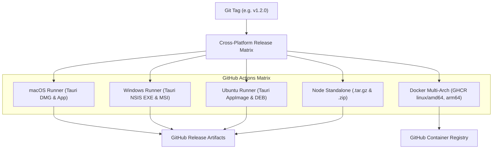

Selvam offers complete deployment flexibility: from a 100% sovereign native desktop application requiring zero external setup, to self-hosted Docker containers, to serverless cloud environments.

<IconCardGrid columns={3}>
  <IconCard
    icon="AppWindow"
    title="Native Desktop & Mobile"
    description="Cross-platform native apps for macOS (.dmg), Windows (.exe), Linux (.AppImage/.deb), and Android (.apk)."
  />
  <IconCard
    icon="Server"
    title="Sovereign Embedded Mode"
    description="Run on any machine with zero dependencies: embedded PGlite initializes in ~450ms to ./data/selvam.db."
  />
  <IconCard
    icon="Boxes"
    title="Automated Releases"
    description="GitHub Actions multi-platform release matrix automatically building installers on tagged versions."
  />
</IconCardGrid>

## Native Desktop & Mobile (Tauri 2.0)

Selvam includes a production-ready Tauri 2.0 Rust shell located in `src-tauri/`. It wraps the web interface in a lightweight, high-performance native OS window with direct filesystem and hardware vault capabilities.

### Development

To run the native desktop shell in development:

```bash
pnpm desktop:dev
```

This launches the Tauri window with hot reloading connected to the local web server.

### Building native installers

To build native release installers for your host platform:

```bash
pnpm desktop:build
```

The build outputs native release packages into `src-tauri/target/release/bundle/`:

| Platform    | Output Bundle            | Target Details                                                |
| ----------- | ------------------------ | ------------------------------------------------------------- |
| **macOS**   | `.dmg` and `.app`        | Universal binary (Apple Silicon `aarch64` and Intel `x86_64`) |
| **Windows** | `.exe` (NSIS) and `.msi` | 64-bit installer with desktop shortcut                        |
| **Linux**   | `.AppImage` and `.deb`   | Portable self-contained binary & Debian/Ubuntu package        |
| **Android** | `.apk`                   | Signed or unsigned Android application package                |

## Standalone Sovereign Mode (Local-First)

You can run Selvam locally in your browser with zero Docker daemons, zero external databases, and zero cloud accounts:

```bash
# Clone the repository
git clone https://github.com/arangates/portfolio.git
cd portfolio

# Install workspace dependencies
pnpm install

# Start the sovereign server
SOVEREIGN_MODE=true pnpm dev:web
```

Open [http://localhost:3001](http://localhost:3001) in your browser.

- **Embedded Database**: PGlite executes PostgreSQL directly inside the Node.js runtime using WebAssembly. It automatically runs all 70 schema migrations in ~450ms and persists to `./data/selvam.db`.
- **Sovereign Session**: You are automatically logged in as the sovereign identity (`sovereign-user` / Aranga) without any login screen or password prompt.
- **Air-Gapped Operation**: Everything runs offline.

## Multi-Architecture GitHub Actions Pipeline

The repository includes a comprehensive GitHub Actions release workflow (`.github/workflows/release.yml`) triggered on any version tag (e.g., `git tag v1.2.0 && git push origin v1.2.0`):



### Published release artifacts

Every release generates:

1. **macOS**: `Selvam_x.y.z_x64.dmg` / `Selvam_x.y.z_aarch64.dmg`
2. **Windows**: `Selvam_x.y.z_x64-setup.exe`
3. **Linux**: `selvam_x.y.z_amd64.AppImage`, `selvam_x.y.z_amd64.deb`
4. **Standalone Archives**: `selvam-vX.Y.Z-standalone.tar.gz` and `selvam-vX.Y.Z-standalone.zip`
5. **Docker Image**: `ghcr.io/arangates/selvam:vX.Y.Z` and `ghcr.io/arangates/selvam:latest`

## Docker deployment

### Pull from GitHub Container Registry

```bash
docker pull ghcr.io/arangates/selvam:latest
docker run -d -p 3001:3001 \
  -e SOVEREIGN_MODE=true \
  -v selvam_data:/app/data \
  --name selvam ghcr.io/arangates/selvam:latest
```

### Local Docker Compose

For environments running Docker Compose:

```bash
# Build and run the entire stack
docker compose up --build -d
```

Services exposed:

- `3001`: Selvam Web Application
- `4000`: Fumadocs Documentation Handbook
- `4983`: Drizzle Studio (relational schema explorer bound to loopback `127.0.0.1`)

## Environment variables

| Variable             | Default            | Purpose                                                                                                           |
| -------------------- | ------------------ | ----------------------------------------------------------------------------------------------------------------- |
| `SOVEREIGN_MODE`     | `true`             | Enables zero-cloud sovereign mode with instant session auto-provisioning.                                         |
| `PGLITE_DATA_DIR`    | `./data/selvam.db` | Local directory for embedded WASM PostgreSQL data files.                                                          |
| `DATABASE_URL`       | None               | Optional connection string to an external PostgreSQL instance (e.g. Neon). When omitted, embedded PGlite is used. |
| `BETTER_AUTH_SECRET` | Auto-generated     | 32+ character master key used by the AES-256-GCM hardware vault and session signer.                               |
| `PORT`               | `3001`             | HTTP port for the web application server.                                                                         |
